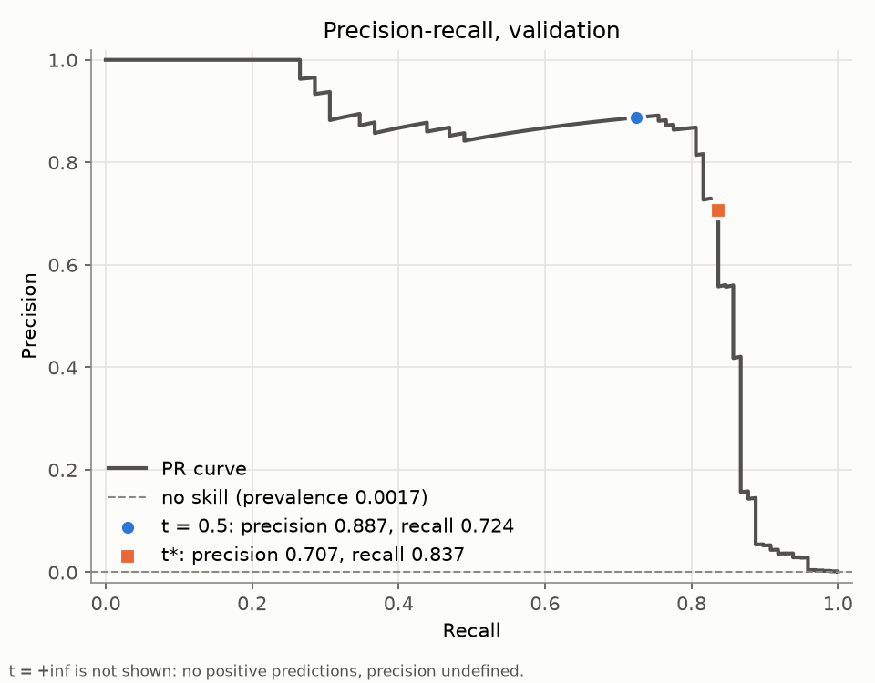
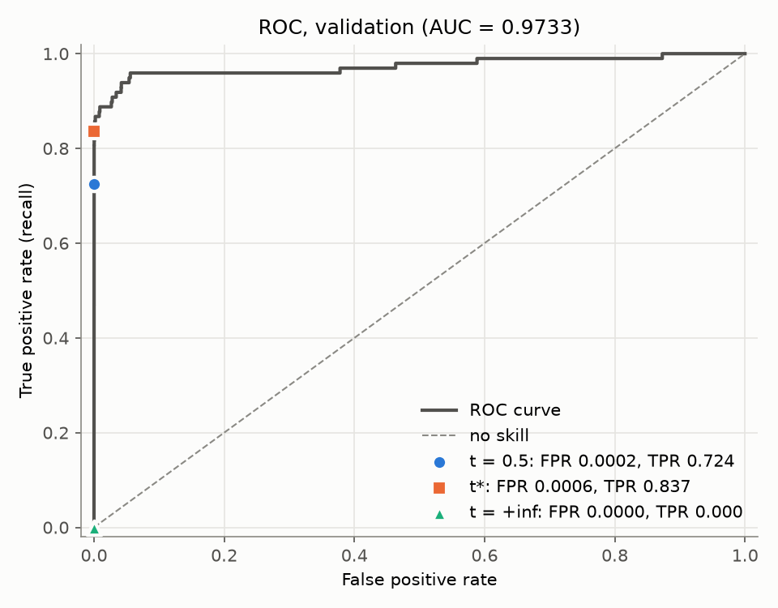

# ЛР2. Поріг рішення під асиметричну ціну помилок

Credit Card Fraud Detection: 284 807 транзакцій, з них 492 шахрайські (`Class = 1`).
Набір даних: https://www.kaggle.com/datasets/mlg-ulb/creditcardfraud (для завантаження потрібен обліковий запис Kaggle).
Файл `creditcard.csv` у репозиторії не зберігається; шлях до локальної копії передається в команді запуску.

## Як запустити

Спершу завантажте `creditcard.csv` за посиланням вище й покладіть його в `lab2/data/` (файл у репозиторій не входить;
за потреби в команді навчання можна вказати будь-який інший шлях до нього).
Далі перейдіть у теку `lab2`. Версії залежностей зафіксовано в `pyproject.toml` / `uv.lock` цієї теки (потрібен Python 3.12).

```
cd lab2

# 1. навчання з локального CSV (один запуск, 12 епох, CPU, float32); --out має бути порожнім або не існувати
uv run python lab2_starter.py --data data/creditcard.csv --out results

# 2. аналіз зі збережених прогнозів, без навчання і без CSV
uv run python analysis.py
```

Код поділено на два файли: `threshold.py` — підрахунок TP/FP/FN/TN і C, швидкий пошук порога, повний перебір і перевірки на наборах A/B/C
(можна запускати окремо: `uv run python threshold.py`); `analysis.py` — точка входу: криві, таблиці, оцінка на test.
`analysis.py` спочатку виконує три перевірки на малих наборах із пункту 3 (через `assert`; за будь-якої розбіжності
виконання зупиняється), а потім записує в `lab2/results/` таблицю кандидатів, криві, порівняльну таблицю та результати на test.

## Дані та підготовка

- Ознаки: `V1`–`V28` і `Amount` (29). `Class` і `Time` до входу моделі не входять. Сире значення `Amount` зберігається окремо для аналізу помилок.
- Поділ 60/20/20, стратифікований, початковий порядок рядків CSV збережено: `train_test_split(test_size=0.4, stratify=Class, random_state=0)`,
  далі відкладені індекси діляться навпіл із `test_size=0.5`, зі стратифікацією за відповідними мітками та `random_state=0`
  (перша частина — validation, друга — test).
- `StandardScaler` навчається **лише на train** і застосовується до validation та test; масиви переведено в `float32`. Класи не балансуються ні відкиданням, ні дублюванням.
- Модель: `Linear(29,32) → ReLU → Linear(32,1)`, `BCEWithLogitsLoss`, Adam зі швидкістю навчання `1e-3`, 12 епох, пакет 1024, `torch.manual_seed(0)`.
  Використано ваги після 12-ї епохи (епоху за validation не вибирали). Оцінка — `sigmoid(logit)`.

| вибірка | об'єктів | шахрайських | частка |
|---|---|---|---|
| train | 170 884 | 295 | 0,1726% |
| validation | 56 961 | 98 | 0,1720% |
| test | 56 962 | 99 | 0,1738% |

**Чому статистики стандартизації не можна обчислювати на всьому наборі:** середнє та стандартне відхилення рядків validation
і test потрапили б у підготовку даних, тобто модель налаштовувалась би з використанням інформації з даних, на яких її потім
оцінюють. Validation і test мають залишатися невідомими даними й перетворюватися лише статистиками train.

## Метрики та вартість

Транзакція прогнозується як шахрайська, якщо `s_i >= t`. Нехай `TP, FP, FN, TN` — лічильники на вибірці:

- вартість: `C(t) = 10·FN(t) + FP(t)` (пропущене шахрайство коштує як десять хибних тривог; `Amount` у формулу не входить);
- precision = `TP / (TP + FP)`, recall = `TP / (TP + FN)`.
  Якщо знаменник нульовий, метрика **не визначена** (наприклад, precision, коли жодна транзакція не прогнозується
  як шахрайська); тоді її не підміняють нулем, а позначають як невизначену.

## Пошук порога (validation)

Кандидати — усі унікальні оцінки validation та `+inf` (`+inf` означає «усі негативні», найменша оцінка — «усі позитивні»).
Рівні оцінки завжди отримують однаковий прогноз, тому поріг допустимий лише в **кінці групи рівних оцінок**.

Алгоритм, O(n log n), без окремого проходу по вибірці для кожного порога:

1. відсортувати оцінки за спаданням (мітки переставляються разом з оцінками);
2. кумулятивні суми позитивних і негативних міток дають `TP` і `FP` для кожного префікса;
3. залишити лише ті префікси, що є останнім елементом групи рівних оцінок, і додати перший рядок для `+inf` (`TP = FP = 0`);
4. `FN = P − TP`, `TN = N − FP`, `C = 10·FN + FP`;
5. `t*` — мінімум `C`; пороги йдуть за спаданням, тому `argmin` (перший мінімум) повертає **найбільший** поріг серед рівних за вартістю.

Повна таблиця з 55 971 кандидата лежить у `results/candidates.csv` (без округлення); зафіксований поріг — у `results/threshold.json`.

### Validation: три правила рішення

| Правило | Поріг | TP | FP | FN | TN | C |
|---|---|---|---|---|---|---|
| Стандартний поріг | 0,5 | 71 | 9 | 27 | 56 854 | 279 |
| Мінімум вартості | t\* = 0,031194 | 82 | 34 | 16 | 56 829 | 194 |
| Усі негативні | +inf | 0 | 0 | 98 | 56 863 | 980 |

### Криві

`results/pr_curve.png`, `results/roc_curve.png` (scikit-learn; позначено три робочі точки). **ROC-AUC на validation = 0,9733.**




Висока ROC-AUC означає, що в середньому шахрайські транзакції ранжуються вище за легітимні. Вона не гарантує ні малих
вартості помилок, ні високої точності (precision): ROC використовує *частку* хибних тривог (FPR), знаменник якої — приблизно
56 863 легітимні транзакції, тож навіть 34 хибні тривоги дають FPR ≈ 0,0006, і крива виглядає майже ідеальною. А precision
і вартість `C` залежать від *абсолютної* кількості хибних тривог відносно лише 98 шахрайських транзакцій, і PR-крива
показує різке падіння precision за recall ≈ 0,8 (0,887 при t = 0,5 і 0,707 при t\*). Крім того, поріг усе одно треба
обрати, а вартість залежить саме від нього.

## Перевірка пошуку на малих наборах (пункт 3)

Той самий список кандидатів будується незалежно; кожен кандидат оцінюється прямим застосуванням правила `s_i >= t` з підрахунком
(повний перебір, лише для малих наборів). Усі лічильники, вартості та вибраний поріг збігаються з реалізацією через кумулятивні суми точно.

Набір A, `s = [0,9; 0,7; 0,7; 0,4; 0,2; 0,1]`, `y = [0; 1; 0; 1; 0; 0]`: **t\* = 0,4, C = 2**

| поріг | TP | FP | FN | TN | C |
|---|---|---|---|---|---|
| inf | 0 | 0 | 2 | 4 | 20 |
| 0,9 | 0 | 1 | 2 | 3 | 21 |
| 0,7 | 1 | 2 | 1 | 2 | 12 |
| 0,4 | 2 | 2 | 0 | 2 | 2 |
| 0,2 | 2 | 3 | 0 | 1 | 3 |
| 0,1 | 2 | 4 | 0 | 0 | 4 |

Дві оцінки 0,7 дають **один** рядок-кандидат, і обидва об'єкти завжди класифікуються однаково
(при t = 0,7: TP = 1, FP = 2 — позитивний і негативний об'єкти з оцінкою 0,7 обидва прогнозуються як шахрайські).

Набір B, `s = [0,9; 0,6; 0,3]`, `y = [0; 0; 0]`: **t\* = +inf, C = 0**

| поріг | TP | FP | FN | TN | C |
|---|---|---|---|---|---|
| inf | 0 | 0 | 0 | 3 | 0 |
| 0,9 | 0 | 1 | 0 | 2 | 1 |
| 0,6 | 0 | 2 | 0 | 1 | 2 |
| 0,3 | 0 | 3 | 0 | 0 | 3 |

За відсутності позитивних міток `FN = 0` завжди, тому будь-який позитивний прогноз лише додає хибні тривоги,
і «усі негативні» — єдиний оптимум.

Набір C, `s = [0,8; 0,5 × 11; 0,2]`, `y = [1; 1; 0 × 10; 0]`: **t\* = 0,8, C = 10**

| поріг | TP | FP | FN | TN | C |
|---|---|---|---|---|---|
| inf | 0 | 0 | 2 | 11 | 20 |
| 0,8 | 1 | 0 | 1 | 11 | 10 |
| 0,5 | 2 | 10 | 0 | 1 | 10 |
| 0,2 | 2 | 11 | 0 | 0 | 11 |

Пороги 0,8 і 0,5 досягають однакового мінімуму `C = 10`; за правилом обирається **найбільший** із них — 0,8. Усі одинадцять оцінок 0,5
утворюють одну групу рівних значень.

## Оцінка на test

Поріг `t*` зчитується з `results/threshold.json` і на test не підбирався.

| Правило на test | Поріг | TP | FP | FN | TN | C | precision | recall |
|---|---|---|---|---|---|---|---|---|
| Стандартний поріг | 0,5 | 71 | 8 | 28 | 56 855 | 288 | 0,899 | 0,717 |
| Мінімум вартості (t\* з validation) | 0,031194 | 80 | 43 | 19 | 56 820 | 233 | 0,650 | 0,808 |

### Аналіз помилок

Перші п'ять хибних тривог і перші п'ять пропущених шахрайств за номером рядка CSV (з 0, без заголовка); повний список — у `results/test_errors.csv`.

| Рядок CSV | Тип помилки | Мітка | Оцінка s | Amount | s − t\* |
|---|---|---|---|---|---|
| 460 | FP | 0 | 0,196 | 2,00 | +0,165 |
| 2961 | FP | 0 | 0,081 | 2,49 | +0,050 |
| 10783 | FP | 0 | 0,966 | 89,99 | +0,935 |
| 13405 | FP | 0 | 0,932 | 89,99 | +0,901 |
| 13617 | FP | 0 | 0,923 | 89,99 | +0,892 |
| 10497 | FN | 1 | 0,011 | 3,79 | −0,020 |
| 52521 | FN | 1 | 0,006 | 105,99 | −0,025 |
| 55401 | FN | 1 | 0,006 | 1,00 | −0,026 |
| 91671 | FN | 1 | 0,0005 | 290,18 | −0,031 |
| 93486 | FN | 1 | 0,018 | 0,00 | −0,013 |

Три з п'яти хибних тривог мають однакову суму (89,99) і дуже високі оцінки (0,92–0,97); ще дві — малі суми поблизу порога.
Усі п'ять пропущених шахрайств лежать трохи нижче порога (на 0,013–0,031) і мають різні суми (0,00–290,18), тобто це
прикордонні випадки, які `Amount` не розділяє. Медіана `Amount` на всьому test дорівнює 22,00, тому сума сама по собі
помилки не характеризує. За десятьма прикладами з 62 помилок про причину помилок моделі судити не можна:
вони лише натякають на можливий повторюваний шаблон для випадків із 89,99, який слід перевіряти на всіх помилках.

## Висновки

- Зміна лише порога за незмінної моделі перевела рішення зі стандартного 0,5 до `t*`. На test це
  **прибрало 9 пропущених шахрайств (FN 28 → 19) ціною 35 додаткових хибних тривог (FP 8 → 43)**; за співвідношення цін 10:1 це знижує C
  з 288 до 233. На validation та сама зміна прибрала 11 FN за 25 додаткових FP (C 279 → 194).
- Результат на validation не гарантує такого самого виграшу на test. `t*` — це мінімум зашумленої функції, оціненої
  лише за 98 шахрайськими об'єктами validation: перехід одного шахрайства через поріг змінює C на 10, тож знайдений мінімум
  частково підігнаний під ці конкретні приклади (мінімум багатьох шумних значень оптимістичний). На test вартість при `t*`
  (233) вища, ніж на validation (194), precision знизилась із 0,707 до 0,650, а економія порівняно з t = 0,5 менша
  (55 проти 85). Інший поділ даних міг би дати інший `t*`.

## Джерела та інструменти

Стартовий код `lab2_starter.py` був наданий викладачем; у цій роботі Claude Code використовувався для допомоги з реалізацією перевірок, графіків і чернетки цього README.
