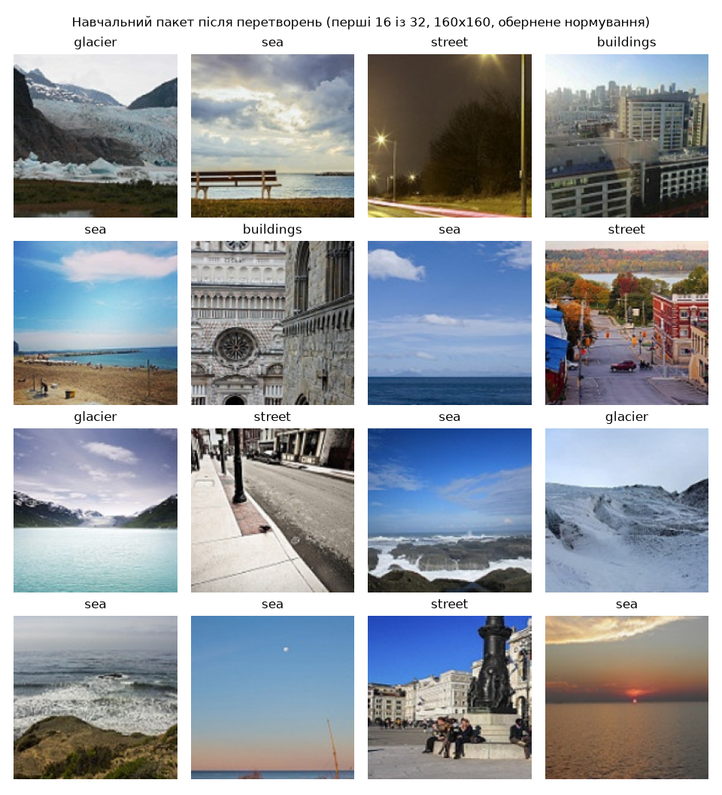
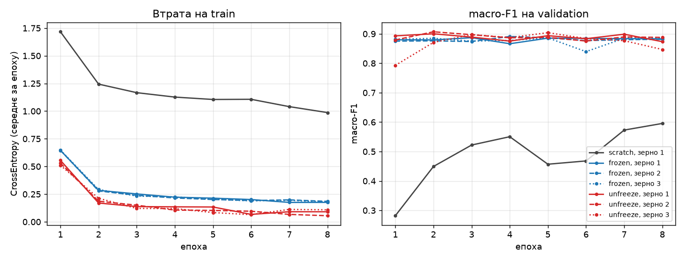
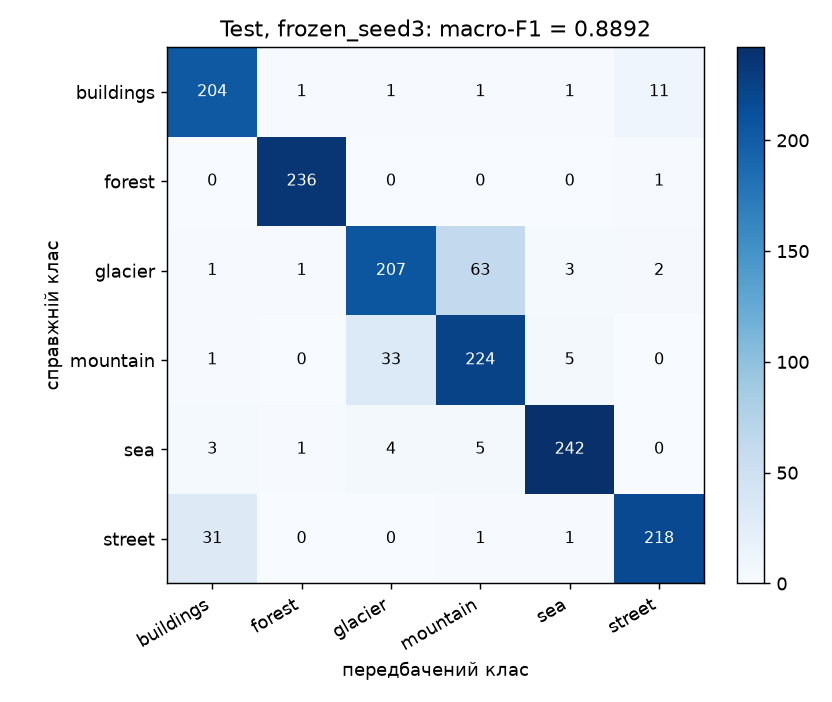
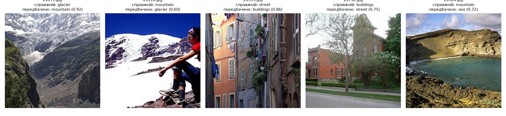

# ЛР3. Обчислювальний експеримент і трансферне навчання

ResNet-18 на 200 зображеннях на клас (Intel Image Classification, 6 класів), три режими навчання за однакового
бюджету в 304 кроки оптимізатора: `scratch` (випадкові ваги, навчається вся мережа), `frozen` (ваги ImageNet, навчається лише
`fc`) і `unfreeze` (ваги ImageNet, навчаються `layer4` і `fc`). Питання роботи: яку частину виграшу дають попередньо навчені ознаки
(Δpre), яку — донавчання кістяка (Δunf), і чи більша кожна з цих різниць за розкид між запусками.

**Коротко:** Δpre = +28,8 пункту macro-F1 при порозі шуму R = 4,1 пункту, тобто ефект у 7 разів більший за розкид.
Δunf = −1,4 пункту, і за модулем це лише 0,34·R: різниця між `unfreeze` і `frozen` не відрізняється від розкиду.
Вибрано запуск `frozen_seed3`; macro-F1 на test — 0,8892.

## Як запустити

Набір: https://www.kaggle.com/datasets/puneet6060/intel-image-classification (до репозиторію не входить). Після розпакування
архіву шлях `--data` має вказувати на теку, в якій лежать `seg_train/` і `seg_test/`. Версії залежностей зафіксовано в
`pyproject.toml` / `uv.lock` у корені репозиторію; вони спільні для всіх лаб. Потрібен Python 3.12.

```
uv sync
cd lab3

# 1. навчання: поділ → split.csv, перевірки пунктів 1–2, сім запусків, журнали, вибір → lab3_model.pt (test не використовується)
uv run python train.py --data <шлях>/intel-image-classification

# 2. аналіз: перевірка хешу split.csv, таблиця, криві, ефекти, перевірка вибору, одноразова оцінка на test (CPU)
uv run python analysis.py --data <шлях>/intel-image-classification
```

`train.py --device auto|cpu|cuda|mps` (за замовчуванням `auto`). Прапорець `--skip-existing` не перенавчає запуски, для яких
уже є `run.json` і `model.pt` на поточному `split.csv`. Перевірки пунктів 1–2 при цьому все одно виконуються.

| Файл | Що містить |
|---|---|
| `common.py` | поділ, датасет за `split.csv`, перетворення, побудова моделі за кроками 1–5, `set_train_mode`, епоха, журнал, правило вибору |
| `train.py` | команда навчання; будь-яка перевірка, що не збіглася з очікуваним, зупиняє її (`assert`) |
| `analysis.py` | команда аналізу; єдине місце, де завантажується test |
| `split.csv` | поділ (`file,label,part`; рядки: train → validation → test, усередині — клас, потім ім'я файлу) |
| `runs/<режим>_seed<зерно>/` | `run.json` і `val_logits.npy` (1498 × 6) для кожного з 7 запусків; `runs/selection.json` — вибір |
| `lab3_model.pt` | ваги вибраного запуску: `state_dict`, `regime`, `seed`, `classes`, `img_size = 160` |
| `results/` | `checks.json` (перевірки 1–2), `train_log.txt` (лог навчання), `analysis.md` і `test_results.json` (вивід аналізу), `confusion_matrix.csv`, `test_logits.npy` |
| `figures/` | `train_batch.png`, `curves.png`, `confusion_matrix.png`, `test_errors.png` |

Ваги окремих запусків (`runs/*/model.pt`) лишилися локально (`.gitignore`); до репозиторію додано лише `lab3_model.pt`.

## Налаштування (як в умові)

- Перетворення train: `RandomResizedCrop(160, scale=(0.7, 1.0))` → `RandomHorizontalFlip()` → `ToTensor()` → `Normalize(mean, std)`;
  validation/test: `Resize((160, 160))` → `ToTensor()` → `Normalize(mean, std)`. `mean`/`std` — статистики ImageNet в усіх режимах.
  Зображення відкриваються через `Image.open(...).convert("RGB")`.
- Модель: `torch.manual_seed(seed)`, `np.random.seed(seed)` → `resnet18(weights=None | IMAGENET1K_V1)` → `fc = Linear(512, 6)` →
  `requires_grad` → `.to(device)` → `AdamW(weight_decay=1e-4)`. Групи: `scratch` — усі параметри з lr 3·10⁻³; `frozen` — `fc` з lr 3·10⁻³;
  `unfreeze` — `fc` з lr 3·10⁻³ і `layer4` з lr 3·10⁻⁴.
- `set_train_mode`: `model.train()`, потім `.eval()` для `conv1, bn1, layer1–layer4` (`frozen`) або для `conv1, bn1, layer1–layer3` (`unfreeze`).
- Train-завантажувач: `batch_size=32, shuffle=True, drop_last=False, num_workers=0`, без власного генератора. Validation і test:
  `batch_size=64`, порядок як у `split.csv`. 8 епох × 38 кроків = 304 кроки. Втрата епохи — `Σ L_b·|b| / 1200`.
  Ваги після 8-ї епохи; без розкладів, обрізання градієнта, AMP, згладжування міток, зважування класів і вибору епохи.
- Повний перелік налаштувань, включно з тими, що лишилися за замовчуванням (зокрема `betas`, `eps` AdamW, `ratio` та `interpolation`
  перетворень), записано в кожен `run.json`.

Усі запуски навчалися на CPU (Intel, 8 потоків PyTorch), у `float32`: Python 3.12.14, PyTorch 2.14.0+cpu, torchvision 0.29.0+cpu.

---

## 1. Перевірки до навчання

### Поділ

Таблиця, побудована з `split.csv` (кількість / сума числових імен файлів):

| Клас | train | validation | test |
|---|---|---|---|
| buildings | 200 / 1 996 761 | 218 / 4 837 323 | 219 / 4 837 559 |
| forest | 200 / 2 032 625 | 237 / 5 276 962 | 237 / 5 291 326 |
| glacier | 200 / 2 183 923 | 276 / 6 135 652 | 277 / 6 157 250 |
| mountain | 200 / 1 950 345 | 262 / 5 789 535 | 263 / 5 849 765 |
| sea | 200 / 1 987 613 | 255 / 5 655 068 | 255 / 5 668 011 |
| street | 200 / 1 841 817 | 250 / 5 541 845 | 251 / 5 547 533 |
| **Разом** | 1200 / 11 993 084 | 1498 / 33 236 385 | 1502 / 33 351 444 |

**Усі 18 клітинок збігаються з контрольною таблицею.** Попарні перетини множин файлів train/validation/test порожні.
SHA-256 `split.csv`: `d3a611aec41f6e335ab58287f10a443f3e0e35aa9adfefae662d48b15af567f9`. Серед 17 034 зображень seg_train і seg_test
55 мають розмір, відмінний від 150 × 150. Їх не відкинуто, розмір вирівнюють `RandomResizedCrop` / `Resize`.

### Пакет після перетворень

Перші 16 зображень першого навчального пакета (`torch.manual_seed(0)`), після аугментацій і з оберненим нормуванням:



### Початкова втрата

Модель зі зерном 1, перший пакет, `set_train_mode`, `torch.no_grad()`:

| Режим | L₀ | ln 6 | L₀ − ln 6 | std логітів | середня max softmax |
|---|---|---|---|---|---|
| scratch | 2,1344 | 1,7918 | +0,343 | 0,504 | 0,286 |
| frozen | 2,2155 | 1,7918 | +0,424 | 0,671 | 0,326 |

L₀ трохи більша за ln 6, і це очікувано. ln 6 — втрата моделі з *рівними* логітами. Стандартна ініціалізація `fc`
(U(−1/√512, 1/√512) для ваг і зміщення) дає ненульові логіти зі std ≈ 0,5–0,7, тож модель уже з першого кроку надає перевагу
якимось класам незалежно від справжньої мітки: середня найбільша ймовірність 0,29–0,33 замість 1/6. Для логітів, не пов'язаних із
міткою, середня крос-ентропія ≥ ln 6 (logsumexp(z) ≥ ln 6 + середнє z), і вона росте з розкидом логітів. Тому у `frozen`, де
ознаки ImageNet мають більшу норму, ніж ознаки випадкової мережі, відхилення більше. Відхилення в 0,3–0,4 узгоджується з випадковою
головою. Помилку нормування чи BN виказали б логіти з розкидом у кілька одиниць і L₀ ≫ 2.

## 2. Перевірка режимів навчання

Кожна перевірка — новий екземпляр моделі (кроки 1–5, зерно 1). Ці моделі не оцінювалися на validation і не зберігалися.

### Параметри

| Режим | Усього параметрів | requires_grad=True | Групи AdamW (параметрів @ lr) | Збіг із таблицею |
|---|---|---|---|---|
| scratch | 11 179 590 | 11 179 590 | 11 179 590 @ 3·10⁻³ | так |
| frozen | 11 179 590 | 3 078 | `fc`: 3 078 @ 3·10⁻³ | так |
| unfreeze | 11 179 590 | 8 396 806 | `fc`: 3 078 @ 3·10⁻³; `layer4`: 8 393 728 @ 3·10⁻⁴ | так |

Кількості — суми `numel()`. В усіх режимах жоден параметр із `requires_grad=False` не потрапив в оптимізатор, а множина параметрів
оптимізатора точно дорівнює множині параметрів із `requires_grad=True` (порівняння за `id`). `weight_decay = 1e-4` в усіх групах.

### Що змінюється під час навчання

Копія повного `state_dict()` → `set_train_mode` → 5 кроків на перших 5 пакетах → точне порівняння (`torch.equal`) окремо для
параметрів і для буферів BN (`running_mean`, `running_var`, `num_batches_tracked`) кожного модуля верхнього рівня.

| Режим | Модуль | Параметри змінилися | Ковзні статистики BN змінилися | Збігається з очікуваним |
|---|---|---|---|---|
| frozen | conv1 | ні | немає BN | так |
| frozen | bn1 | ні | ні | так |
| frozen | layer1 | ні | ні | так |
| frozen | layer2 | ні | ні | так |
| frozen | layer3 | ні | ні | так |
| frozen | layer4 | ні | ні | так |
| frozen | fc | так | немає BN | так |
| unfreeze | conv1 | ні | немає BN | так |
| unfreeze | bn1 | ні | ні | так |
| unfreeze | layer1 | ні | ні | так |
| unfreeze | layer2 | ні | ні | так |
| unfreeze | layer3 | ні | ні | так |
| unfreeze | layer4 | так | так | так |
| unfreeze | fc | так | немає BN | так |

### Дослід із навмисною помилкою (`frozen`, `model.train()` замість `set_train_mode`)

**Прогноз** (записано в README до першого запуску коду):

- Параметри замороженого кістяка не зміняться. У них `requires_grad=False`, градієнт не обчислюється, і їх немає в оптимізаторі,
  тож ні крок Adam, ні weight decay їх не торкаються. Параметри `fc` зміняться, як і з правильною функцією.
- Ковзні статистики BN зміняться в усіх модулях кістяка з BN (`bn1`, `layer1`–`layer4`). У режимі `train()` BatchNorm на кожному
  прямому проході нормує за статистиками пакета й оновлює `r ← 0,9·r + 0,1·(статистика пакета)`, а `num_batches_tracked` зросте на 5.
  Це буфери, а не параметри, і оновлюються вони в прямому проході, а не кроком оптимізатора, тому `requires_grad=False` на них не
  впливає. За 5 кроків статистики зсунуться на 1 − 0,9⁵ ≈ 41% відстані від значень ImageNet до статистик пакетів Intel: зміна
  ненульова, порядку 10⁻²–10⁻¹ для `layer1.0.bn1`.
- З кривої втрати на train цього майже не видно. Голова отримує ознаки, нормовані за статистиками пакета, і навчається саме на них,
  тож втрата падатиме нормально. Проблема проявиться на validation: в `eval()` BN нормує за вже зсунутими ковзними статистиками, тобто
  ознаки на оцінці відрізняються від тих, на яких училася голова, а «заморожений» кістяк насправді змінюється з кожним пакетом.
  Виявити це можна лише прямою перевіркою буферів або за validation.

**Результат:**

| Режим | Модуль | Параметри змінилися | Ковзні статистики BN змінилися | Збігається з очікуваним (для правильного frozen) |
|---|---|---|---|---|
| frozen | conv1 | ні | немає BN | так |
| frozen | bn1 | ні | **так** | ні |
| frozen | layer1 | ні | **так** | ні |
| frozen | layer2 | ні | **так** | ні |
| frozen | layer3 | ні | **так** | ні |
| frozen | layer4 | ні | **так** | ні |
| frozen | fc | так | немає BN | так |

`layer1.0.bn1` після 5 кроків: max |Δ running_mean| = **0,0886**, max |Δ running_var| = **0,1484**, `num_batches_tracked`: 0 → 5.

**Зіставлення з прогнозом:** збіглося повністю. Параметри кістяка не змінилися, статистики BN змінилися в усіх п'яти модулях із BN,
порядок зміни — 10⁻¹. Перевірка, яка дивиться лише на параметри (або на `requires_grad`), цієї помилки не виявляє.

**Чому `requires_grad=False` не захищає статистики.** `running_mean` і `running_var` — буфери модуля, а не параметри. Їх оновлює
сам `BatchNorm2d.forward`, коли `module.training == True`, без градієнта й оптимізатора. Від цього захищає лише режим `eval()`
модуля. Тому заморожені модулі мусять бути в `eval()`: інакше на train вони нормують за статистиками пакета (32 або 16 зображень), а
на оцінці — за ковзними статистиками, що «пливуть» під дані Intel. Ваги ж, з якими ці статистики узгоджувалися під час навчання на
ImageNet, лишаються незмінними.

**Чому для `layer4` в `unfreeze` оновлення правильне.** Ваги `layer4` навчаються, тож розподіл активацій усередині нього змінюється з
кожним кроком. Щоб в `eval()` BN нормував так само, як під час навчання (за статистиками пакетів), ковзні статистики мусять
відстежувати розподіл саме цих даних і саме поточних ваг. Це звичайна поведінка BN у модулі, що навчається.

Усі перевірки пунктів 1–2 збіглися з очікуваними. Лише після цього запускалися сім запусків. Повний вивід перевірок —
`results/checks.json` і `results/train_log.txt`.

## 3. Сім запусків

Числа нижче — з виводу `analysis.py` (`results/analysis.md`).

| # | Режим | Зерно | Втрата train, епоха 8 | macro-F1 validation, епоха 8 | Час навчання, с |
|---|---|---|---|---|---|
| 1 | scratch | 1 | 0,9869 | 0,5955 | 530 |
| 2 | frozen | 1 | 0,1759 | 0,8829 | 297 |
| 3 | frozen | 2 | 0,1848 | 0,8814 | 268 |
| 4 | frozen | 3 | 0,1788 | 0,8864 | 296 |
| 5 | unfreeze | 1 | 0,0908 | 0,8735 | 327 |
| 6 | unfreeze | 2 | 0,0551 | 0,8880 | 364 |
| 7 | unfreeze | 3 | 0,1083 | 0,8469 | 330 |

Час — настінний час 8 епох навчання разом з оцінкою validation після кожної епохи, CPU.



`frozen` дає ≈ 0,88, як орієнтир в умові. `scratch` помітно нижчий, але далеко від рівня вгадування (1/6). `unfreeze` має найнижчу
втрату на train (0,06–0,11 проти 0,18 у `frozen`), але не вищий macro-F1 на validation: 8,4 млн параметрів `layer4` на 1200 зображеннях
швидше підганяються під train, ніж покращують узагальнення.

**Журнали.** Кожен `runs/<режим>_seed<зерно>/run.json` містить: зерно й усі налаштування перетворень, моделі, оптимізатора та циклу
(включно з усталеними), коміт і позначку незакомічених змін, SHA-256 `split.csv`, версії Python / PyTorch / torchvision / NumPy,
пристрій, втрату на train і macro-F1 на validation за кожну епоху, час епох і загальний час навчання. Поруч лежить `val_logits.npy`.
`analysis.py` перевіряє, що хеш `split.csv` однаковий у всіх семи журналах і збігається з хешем поточного файлу (інакше — `sys.exit`
з помилкою), і що macro-F1, порахований зі збережених логітів, дорівнює записаному в журналі.

**Коміт у журналах.** Усі сім запусків записали той самий коміт `07c2cfe` з `uncommitted_changes: true`: на момент навчання код
ЛР3 ще не був закомічений. Тому в журнали також записано SHA-256 кожного файлу коду (`code_sha256`). Для `common.py`, `analysis.py`,
`pyproject.toml` і `uv.lock` він збігається з версіями в репозиторії. `train.py` відрізняється одним рядком: після завершення всіх
семи запусків команда впала з `NameError` на записі `runs/selection.json` (не було імпорту `RUNS_DIR`). Імпорт виправлено, і
команду повторено з `--skip-existing`: перевірки пунктів 1–2 дали ідентичний вивід, запуски не перенавчалися, вибір і
`lab3_model.pt` записано заново. На навчання це виправлення не впливає; обидва логи — у `results/train_log.txt`.

## 4. Розклад ефектів

$$
\bar F_r = \frac{1}{3}\sum_{s=1}^{3} F_{r,s},\qquad R_r = \max_s F_{r,s} - \min_s F_{r,s},\qquad R = \max(R_\text{frozen}, R_\text{unfreeze})
$$

$$
\Delta_\text{pre} = \bar F_\text{frozen} - F_\text{scratch,1},\qquad \Delta_\text{unf} = \bar F_\text{unfreeze} - \bar F_\text{frozen},\qquad
\Delta_\text{pre} + \Delta_\text{unf} = \bar F_\text{unfreeze} - F_\text{scratch,1}
$$

| Величина | Значення |
|---|---|
| F̄_frozen, R_frozen | 0,8836, 0,0051 |
| F̄_unfreeze, R_unfreeze | 0,8694, 0,0411 |
| F_scratch,1 | 0,5955 |
| R | 0,0411 |
| Δpre | +0,2880 — **вартий перевірки** (\|Δpre\| = 7,0·R) |
| Δunf | −0,0141 — **не відрізняється від розкиду** (\|Δunf\| = 0,34·R) |
| Δpre + Δunf | +0,2739 |

Правило: якщо |Δ| ≤ R, різниця не відрізняється від розкиду і результату немає. Якщо |Δ| > R, ефект вартий перевірки, але не
доведений: R з трьох значень — груба й дуже неточна оцінка шуму (SD(R) ≈ 0,89σ), а не довірчий інтервал.

**Що змінює зерно.** Зерно засіває глобальний генератор PyTorch, тому в усіх режимах воно визначає порядок пакетів (`shuffle`) і
випадкові аугментації (`RandomResizedCrop`, `RandomHorizontalFlip`), а також ініціалізацію `fc`. Далі режими відрізняються:

- `scratch` — ще й ініціалізацію **всіх** 11,2 млн параметрів. Траєкторія невипуклої оптимізації з нуля залежить від зерна найбільше.
- `frozen` — більше нічого: кістяк фіксований (`eval()`, ваги ImageNet), тож ознаки залежать лише від аугментації. Навчання `fc` на
  фіксованих ознаках — майже випукла задача (мультиноміальна логістична регресія), і різні зерна приходять майже в ту саму точку.
  Звідси малий розкид, R_frozen = 0,005.
- `unfreeze` — випадковість порядку й аугментацій впливає ще й на траєкторію 8,4 млн параметрів `layer4`, де задача невипукла, а BN
  працює на пакетах із 32 (і одному з 16) зображень. Модель швидко перенавчається (втрата train 0,06–0,11), і macro-F1 на validation
  коливається від епохи до епохи: у зерна 3 він 0,904 на 5-й епосі і 0,847 на 8-й. Оскільки береться саме 8-ма епоха, ці коливання
  потрапляють у розкид: R_unfreeze = 0,041, у 8 разів більше, ніж у `frozen`. Розкиди двох режимів не зобов'язані бути однаковими.
  Це властивість режиму, а не лише шуму вимірювання.

**Чому R не характеризує розкид запуску 1.** R виміряно на запусках 2–7, тобто на режимах із попередньо навченим кістяком.
`scratch` має принципово інше джерело випадковості (ініціалізацію всієї мережі) і лише один запуск, тож його розкиду ми не знаємо.
Крива запуску 1 показує, що він великий: між сусідніми епохами macro-F1 стрибає на 0,09–0,10 (0,550 → 0,457 → 0,468 → 0,573 → 0,596),
а це більше за R. Отже, F_scratch,1 могло б легко бути на кілька пунктів іншим за іншого зерна. **Висновок щодо Δpre це не змінює:**
навіть якщо приписати `scratch` розкид порядку 0,1 (найбільший стрибок на його кривій), Δpre = 0,288 утричі більший. Його точна
величина (28,8 пункту) — лише оцінка з одного запуску `scratch`.

**Чи однаковий бюджет за часом.** Ні. Однаковий бюджет у *кроках* (304), але не в часі: `scratch` — 530 с (≈ 66 с/епоху), `unfreeze` —
327–364 с (≈ 41–46 с), `frozen` — 268–297 с (≈ 34–37 с). У `frozen` зворотний прохід іде лише через `fc` (ознаки кістяка не потребують
градієнта), в `unfreeze` — через `layer4`, у `scratch` — через усю мережу, плюс оновлення AdamW для 11,2 млн параметрів. За однакового
бюджету *часу* `scratch` отримав би лише ≈ 55% кроків `frozen`, тобто його відставання за рівного часу було б ще більшим.

## 5. Вибір конфігурації і тестова оцінка

**Вибір (у команді навчання, лише за validation).** Середні: `scratch` 0,5955, `frozen` 0,8836, `unfreeze` 0,8694 → режим `frozen`.
Серед його запусків найбільший F_{r,s} у зерна 3 (0,8864) → **`frozen_seed3`**, ваги збережено в `lab3_model.pt`.
**Оскільки |Δunf| ≤ R, вибір між `frozen` і `unfreeze` визначив шум.** Процедура від цього не змінювалася: за іншої трійки зерен
міг виграти `unfreeze`.

`analysis.py` перевіряє вибір: застосовує те саме правило до семи журналів і порівнює з `regime`/`seed` у `lab3_model.pt`. Крім того,
він переобчислює на CPU логіти validation для ваг із `lab3_model.pt` і порівнює зі збереженими `val_logits.npy` вибраного запуску:
максимальна різниця 0,0, збіг argmax 100%. Тобто файл містить саме ці ваги.

**Test — один прохід, CPU, лише в `analysis.py`.**

| Величина | Значення |
|---|---|
| macro-F1 test | **0,8892** |
| accuracy test, p | 0,8862 (n = 1502) |
| SE частки правильних √(p(1−p)/n) | 0,0082 |
| macro-F1 validation вибраного запуску | 0,8864 |
| test − validation | +0,0028 |

Матриця плутанини на test (рядки — справжній клас, стовпці — передбачений):

| справжній \ передбачений | buildings | forest | glacier | mountain | sea | street | усього |
|---|---|---|---|---|---|---|---|
| **buildings** | 204 | 1 | 1 | 1 | 1 | 11 | 219 |
| **forest** | 0 | 236 | 0 | 0 | 0 | 1 | 237 |
| **glacier** | 1 | 1 | 207 | 63 | 3 | 2 | 277 |
| **mountain** | 1 | 0 | 33 | 224 | 5 | 0 | 263 |
| **sea** | 3 | 1 | 4 | 5 | 242 | 0 | 255 |
| **street** | 31 | 0 | 0 | 1 | 1 | 218 | 251 |



**Оптимізм вибору.** Вибір найкращого з трьох запусків робить його валідаційне число зміщеним угору. У наших числах цього не видно:
test навіть на 0,0028 *вищий* за validation. Причина — порядки величин. Зміщення не більше, ніж max − середнє серед зерен `frozen`
(0,8864 − 0,8836 = 0,003), бо розкид `frozen` дуже малий. А шум від скінченності вибірки на test — SE ≈ 0,008 для accuracy,
і validation (n = 1498) має такий самий власний шум, тож SE різниці test − validation ≈ 0,012. Зміщення в 0,003 тоне в шумі вчетверо
більшому, тож різниця може мати будь-який знак. Додатний знак тут — просто випадковість конкретних 1502 зображень test.

### П'ять характерних помилок

П'ять найчастіших позадіагональних пар (за рівної кількості — за індексом справжнього, потім передбаченого класу; тому з двох пар
по 5 помилок взято mountain → sea, а не sea → mountain). Для кожної пари взято перший за іменем файл test із такою помилкою.

| Файл | Справжній клас | Передбачений клас | Імовірність передбаченого класу | Кількість таких помилок у test |
|---|---|---|---|---|
| 20179.jpg | glacier | mountain | 0,9199 | 63 |
| 20116.jpg | mountain | glacier | 0,5996 | 33 |
| 20353.jpg | street | buildings | 0,8640 | 31 |
| 20752.jpg | buildings | street | 0,7497 | 11 |
| 20304.jpg | mountain | sea | 0,7211 | 5 |



- **20179.jpg (glacier → mountain): сцена містить обидва класи.** Гірська долина з язиком льодовика, гірські схили займають більшу
  частину кадру.
- **20116.jpg (mountain → glacier): сцена містить обидва класи.** Засніжена вершина з білими полями снігу/льоду на передньому плані,
  модель вагається (0,60).
- **20353.jpg (street → buildings): сцена містить обидва класи.** Вузька вулиця, у кадрі майже самі фасади будинків, проїжджої
  частини майже не видно.
- **20752.jpg (buildings → street): сцена містить обидва класи.** Цегляна будівля за деревами з дорогою й тротуаром на передньому плані.
- **20304.jpg (mountain → sea): сцена містить обидва класи.** Схили кратера над бухтою: вода займає центр кадру, тож прогноз «sea»
  природний.

Плутанина **glacier ↔ mountain** (63 + 33 = 96 із 171 помилки) — **властивість набору**, а не дефект, який треба «виправляти». Класи
визначено за різними ознаками сцени (лід/сніг чи рельєф), і більшість фотографій льодовиків — це водночас і гори. Так само
перетинаються buildings ↔ street (31 + 11 = 42 помилки): на вуличній сцені майже завжди є будинки. Серед п'яти прикладів немає ні
явної помилки розмітки, ні помилки моделі на однозначному зображенні. Усі п'ять — сцени з двома класами, де мітка відображає
«головний» об'єкт за задумом розмітника.

## 6. Висновок

**Ефект попереднього навчання, Δpre.** Напрям: попередньо навчені ознаки ImageNet *підвищують* якість. Величина: +28,8 пункту macro-F1
(F̄_frozen = 0,8836 проти F_scratch,1 = 0,5955). Співвідношення з розкидом: |Δpre| = 0,288 у 7 разів більше за R = 0,041 і втричі
більше за найбільші стрибки кривої `scratch` між епохами (≈ 0,1). Ефект вартий перевірки й дуже ймовірно реальний, хоча його точна
величина спирається на один запуск `scratch`.

**Ефект розморожування, Δunf.** Напрям: донавчання `layer4` дало в середньому *нижчий* macro-F1, ніж заморожений кістяк. Величина:
−1,4 пункту (F̄_unfreeze = 0,8694 проти F̄_frozen = 0,8836). Співвідношення з розкидом: |Δunf| = 0,014 становить лише 0,34·R
(R = R_unfreeze = 0,041). **Різниця не відрізняється від розкиду: результату немає** — ні виграшу, ні програшу від розморожування
ми не виміряли. Сама величина розкиду при цьому інформативна: `unfreeze` у 8 разів менш стабільний між зернами (R 0,041 проти 0,005).

Повний виграш трансферу відносно навчання з нуля — Δpre + Δunf = +27,4 пункту, і майже весь він припадає на попередньо навчені
ознаки. Обидва ефекти виміряно за конкретного бюджету в 304 кроки (8 епох) без розкладу швидкості навчання. З довшим навчанням
`scratch` міг би скоротити відставання: його крива на 8-й епосі ще росте, а втрата на train (0,99) далека від насичення.

Для нової задачі з 200 зображеннями на клас я взяв би **`frozen`**: за цього бюджету він не гірший за `unfreeze` у межах шуму,
має у 8 разів менший розкид між зернами (а отже, передбачуваніший результат одного запуску) і навчається найшвидше
(≈ 270–300 с проти ≈ 330–360 с в `unfreeze` і 530 с у `scratch` на CPU).

## Відхилення та примітки

- Відхилень від фіксованих налаштувань немає. Навчання й test — на CPU, `float32`.
- Окрім обов'язкових, додано перевірки: у буферах BN порівнюється також `num_batches_tracked`; `analysis.py` звіряє збережені
  логіти validation із журналами та ваги `lab3_model.pt` з логітами вибраного запуску.
- Повторний запуск `train.py` з `--skip-existing` (див. пункт 3, «Коміт у журналах») не змінив ні перевірок, ні запусків.

## Джерела та інструменти

- Набір Intel Image Classification (Kaggle, puneet6060); ваги `ResNet18_Weights.IMAGENET1K_V1` з torchvision.
- Документація PyTorch / torchvision (`resnet18`, `BatchNorm2d`, `AdamW`, `transforms`), scikit-learn (`f1_score`, `confusion_matrix`).
- Генеративний асистент Claude (Anthropic, через Claude Code) допомагав писати код (`common.py`, `train.py`, `analysis.py`) і чернетку
  цього README. Усі числа отримано запуском наведених команд, тестові — з виводу `analysis.py`.
